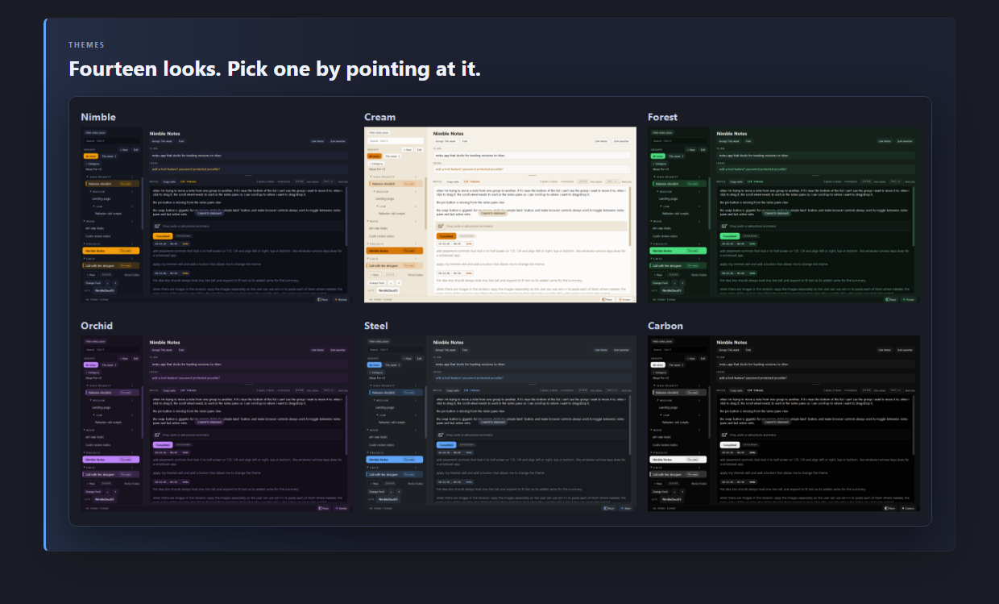
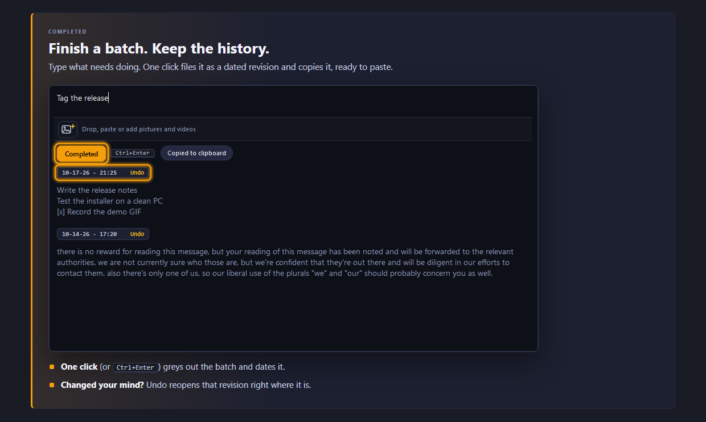
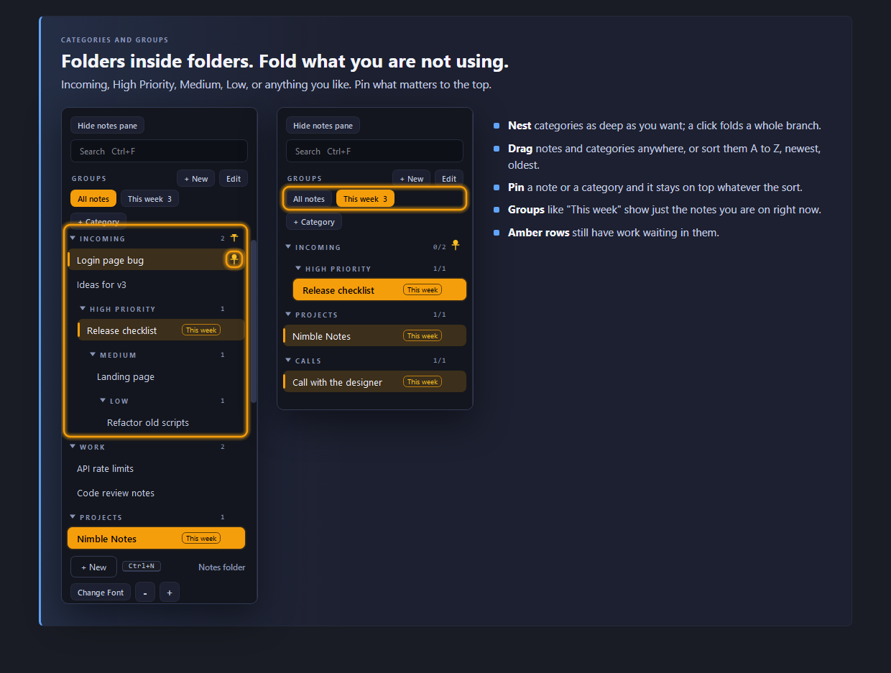
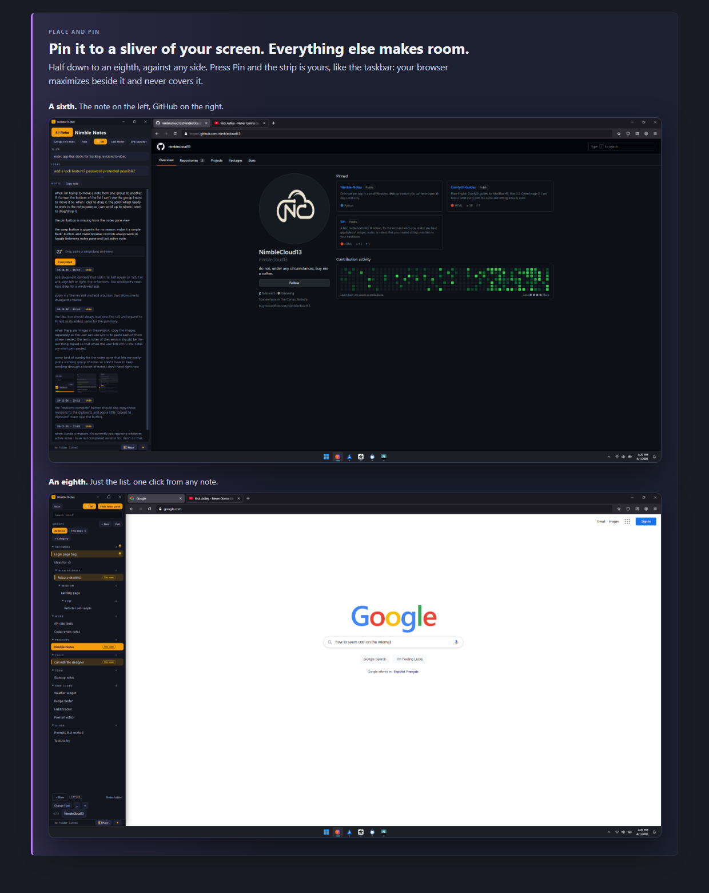
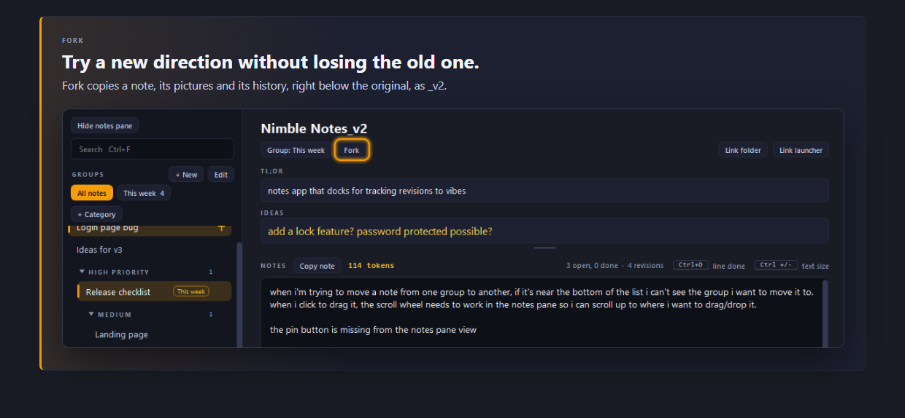

# Nimble Notes

NimbleCloud13 - nimblecloud13@gmail.com - https://github.com/nimblecloud13

One note per app, in a small desktop window you can leave open all day.

It is a native Windows window, not a browser page. There is no server and no port, nothing is
downloaded and nothing leaves this computer. With the window open it holds about 45 MB of memory and
uses no CPU while idle. Hidden in the tray it hands most of that back to Windows.

## A quick look

The same tour as a page: open `Nimble_Notes_Intro.html` in a browser.

## Run it

1. `install.bat` (once). Creates `.venv` and installs the Qt toolkit.
2. `launch_nimble_notes.bat`. The window opens and an amber icon appears in the tray.

The X hides the window; the app keeps running in the tray. Click the tray icon to bring it back,
right-click it for **Quit**. Launching it a second time shows the window that is already running.
`.venv\Scripts\pythonw.exe app.py --quit` asks the running copy to save and close.

## The window

- **Left column**: every note, under its category. Drag a row to reorder it or move it into another
  category. Right-click a row for rename, Fork, pin, folder, move and remove. Click a category to pick
  it (+ New then adds the note at its top); click its arrow, or double-click it, to fold it. Under the
  search box: **Groups** with **All notes** and one button per group, then **+ Category** right above
  the first category. At the bottom: **+ New**, **Change Font** with **-** and **+** for the text size,
  and NimbleCloud13. The note you are on is lit in a lighter navy; a note with open lines has an amber
  wash and an amber bar, and is lit gold when it is the one you are on.
- **Names come first.** When the list gets narrow, the tags on a row go before any letter of the
  name is cut.
- **TL;DR box**: what the app is for. One line tall when empty, growing with its text.
- **Ideas box**: half-thoughts that are not revision notes yet, in a lighter gold and a little larger
  than the notes. Saved as `ideas.txt` in the entry's folder. Drag the small bar under it to make it
  taller or shorter (the notes take the rest); double-click the bar to let it grow with its text.
- **Notes pane**: your notes for that app. The gold number on its label row is the size, in tokens,
  of what you are writing.

Everything saves by itself about a second after you stop typing.

| Keys | Does |
| --- | --- |
| Ctrl+Enter | Completed: grey out everything typed and file it as the next revision |
| Ctrl+D | Tick off the current line (or every selected line), or bring it back |
| Ctrl+Z / Ctrl+Y | Undo or redo moving a note (in the text boxes they undo and redo typing) |
| Enter (in the list) | Open the note, in one-pane view too |
| Ctrl + and Ctrl - | Notes text bigger or smaller; Ctrl+0 resets. Ctrl with the mouse wheel works too |
| Ctrl+F | Search names, TL;DR, ideas and note text. Esc clears it |
| Ctrl+N | New note under the current one |
| Ctrl+G | Switch the list between the groups shown last and every note |
| F2 | Rename the current note (or double-click its name) |
| Del | Remove the note selected in the list (a toast offers Undo) |
| Mouse back / forward | Walk through the notes you visited; with one pane showing, switch between the list and the note |

## New notes

**+ New** (or Ctrl+N) adds a note with its name ready to type, under the note you are on, or at the
top of the category you clicked last. Press Enter after the name and the
cursor goes to the notes. A new note that is left blank is not kept.

## Completed

The notes pane reads top to bottom: the text you are typing, the picture strip, the **Completed**
button, then everything finished so far, greyed out, newest first, each batch under a tag with its
date and time.

Press the button (or Ctrl+Enter) when a batch is done. It is greyed out and filed as the next
revision, and the space above is cleared. A toast offers Undo. What was completed is also copied to
the clipboard: the note's name, a blank line, then the text. When the revision has pictures, each
picture is copied first, one at a time, so Windows clipboard history (Win+V) holds every one, and
the text is copied last so a plain Ctrl+V pastes the text.

Each revision's tag ends in **Undo**: click it and that revision becomes editable again where it
is. Its tag then reads **Completed**; click it when you are done.

Ctrl+D greys single lines inside the text you are still working on.

## Categories

A new list starts with:

    Incoming
      High Priority
        Medium
          Low
    Work
    Projects
    Calls
    Team
    Vibe Coded
    Other

- **Pick**: click a category's name and it lights up; + New adds the next note at its top.
- **Fold**: click a category's arrow (or double-click its name) to hide everything inside it; do it
  again to show it.
- **Move notes**: drag a note into another category, or right-click it and use **Move to**. While a
  note is held, the mouse wheel scrolls the list, and holding it near the top or bottom edge does too.
  Ctrl+Z puts it back, Ctrl+Y moves it again.
- **Move categories**: drag a heading. Dropped right under another heading it goes inside that
  category; dropped anywhere else it goes after the category above. Everything inside it comes along.
- **Right-click a category** to sort its notes, sort the categories beside it, fold, pin, rename,
  add a subcategory, move it, or remove it (its notes go to the category above, with Undo).

Notes sort by My order, A to Z, Z to A, Oldest first, Newest first or Recently edited. Each
category keeps its own choice, shown in small amber text on its heading.

**Pins**: every row has a small pin at its right end. A pinned note stays at the top of its
category; a pinned category stays first among the categories beside it.

## Fork

**Fork**, in the row under the note's name (or right-click a row), makes a copy right below it named `_v2`, or
the next free number. The copy has the notes, ideas, TL;DR, folder, launcher, groups and
pictures.

## Fonts

**Change Font**, at the bottom left, opens one list of fonts, A to Z, each name written in its own
font. A click sets it for the whole app at once, and it is kept after a restart. Segoe UI is the
default.

Arial, Calibri, Cambria, Consolas, Georgia, IBM Plex Sans, Inter, JetBrains Mono, Lato, Montserrat,
Nunito, Open Sans, Poppins, Red Hat Display, Roboto, Segoe UI, Source Sans 3, Tahoma, Times New Roman,
Trebuchet MS, Verdana, Work Sans.

The bundled fonts are in `fonts/` under the SIL Open Font License; the others come with Windows.

## Placing the window

**Place**, in the status bar, opens a grid of little screens: half, third, quarter, fifth, sixth,
seventh and eighth against any side, and the four corners. Against the left or right side at a fifth or
narrower, Hide notes pane turns on by itself. Click one and the window takes that part of the screen, like
Windows+arrow keys, and comes back there after a restart. **Full screen** and **Move to the next
screen** are in the same menu.

**Pin**: when the window is docked against a side (not a corner), a **Pin** button shows in the row
under the note's name. Pinned, that strip of the screen is reserved the way the taskbar is: other windows keep
out of it, and Nimble Notes stays where it is.

**The top left corner**: click the very top left corner of the screen and Nimble Notes comes to the
front, over everything, from wherever it is, even hidden in the tray.

## One pane at a time

**Hide notes pane**, at the top of the list, shows the list or the note, not both, whenever the
window is not full screen (below about 380 px wide it always works this way). In the list, **Back**
goes to the note (Pin and Hide notes pane move to the right end of that row, out of the way). In the
note, **All Notes**, beside its name, goes back to the list. The mouse's back and forward buttons
switch between the list and the note too. Clicking a note opens it when you let go of the mouse; holding and dragging a note moves it
without opening it.

## Themes

**Theme**, beside Place, offers 14 themes: Nimble (the default), Cream, Fog, Deep Sea, Furnace, Coal,
Forest, Moss, Orchid, Blush, Graphite, Carbon, Steel and Espresso. Point at a name to see the app in
it; click to keep it, and the taskbar and tray icons take its color. The tray menu has the same list.

## Groups

A group is a short list of notes to work on together. A note can be in several groups.

- **See groups**: click a group's button above the list (it lights gold). Click more groups to show
  their notes too; click a lit one to stop showing it. **All notes** shows everything and is lit while
  it is what the list shows. Ctrl+G flips between the groups shown last and every note.
- **Make a group**: **+ New** beside the Groups label, type its name, click the notes that belong in
  it, then **Done**. Typing the name of a group that already exists opens that group.
- **Change a group**: **Edit** (or right-click its button). Rename, delete, add and take out notes,
  add a whole section, or add every note with open lines. **Undo** steps back through the changes.
- A note in a group wears the group's name as a small tag on its row and a **Group:** chip under its
  title; click the chip to tick it in or out of any group.

## Pictures and videos

Add them with the button at the left of the strip, by dragging files onto the note, or with Ctrl+V.
Each is copied into `images/<note name>/`; the original is never touched. They belong to the batch
they were added to and are filed with it.

Click a thumbnail to enlarge it: arrows step through, the wheel zooms, Esc closes, **Copy image**
copies it. The small x on a thumbnail takes the picture off the note after showing where the file
lives. The app never deletes anything from the images folder, and says so each time that folder
passes another 5 GB.

## Copy note and the token count

**Copy note** puts the whole note on the clipboard: the name, the open text, then every revision under
its number and date. The gold number beside it counts the tokens in what you are writing.

## Open folder and Launch

These sit at the right end of the row under the note's name, with Pin; Group and Fork are at its
left. **Open folder** opens the
app's folder in Explorer, **Change linked folder** picks another one, and **Launch** runs the app's
launch file as a double-click would (it looks for `launch_<name>.bat`, `launch.bat`, `run.bat`,
`start*.bat`, a .bat or .exe named after the folder). **Link launcher** points it at any file.

The folder is also shown at the bottom left of the status bar. Click it for a card with **Open in
Explorer** and **Change folder**.

## Where things are saved

| File | Holds |
| --- | --- |
| `notes/<Name>/<Name>.txt` | The notes for one entry, as plain text |
| `notes/<Name>/ideas.txt` | That entry's Ideas box |
| `images/<Name>/` | Every picture and video added to that entry |
| `data/apps.json` | The list: names, categories, folders, launch files, TL;DRs |
| `data/state.json` | Window place, theme, font, one-pane choice, Ideas height, sort choices, groups, text size |
| `data/removed/` | Removed entries; right-click the list for Restore removed |

A notes file is the open text first, then each revision under a line of its own, newest first:

    still to do
    - [x] a line ticked off with Ctrl+D
    --- Revision 2 | 10-10-26 20:31 ---
    the second batch

    --- Revision 1 | 10-10-26 18:02 ---
    the first batch

Pictures are listed at the end of the part they belong to: `[image] screenshot.png` or
`[video] clip.mp4`. The files can be edited while the app is open; it picks the change up the next
time its window is clicked. Folders under your home directory are stored as `~/...`.

## Start with Windows

The first launch adds a startup entry so Nimble Notes starts hidden in the tray when you sign in.
Turn it off or on from the tray menu.

## Files

- `app.py` - the window, tray icon and startup
- `store.py` - reading and writing the files in `data/`
- `media.py` - the picture strip, the enlarged picture view, the small pop-up, the resize grip
- `theme.py` - the stylesheet, built from the theme picked
- `nimble_themes.py` - the 14 themes
- `fonts/` - the bundled fonts and `fonts.json`, the list Change Font reads

## Links

**NimbleCloud13**, beside the version number at the bottom left, opens links to GitHub
(github.com/nimblecloud13) and Buy me a coffee (buymeacoffee.com/nimblecloud13).

## License

Copyright (c) 2026 NimbleCloud13.

Nimble Notes is open source under the GNU Affero General Public License, version 3 or any later
version (AGPL-3.0-or-later). The full text is in [LICENSE](LICENSE). Anyone can use, change and
share it for free. Changed versions that are shared or run as a network service must be released
under the same license, with their source.

To use Nimble Notes under other terms, for example in a closed-source product, a commercial
license is available: write to nimblecloud13@gmail.com.

The bundled fonts in `fonts/` keep their own SIL Open Font License.
