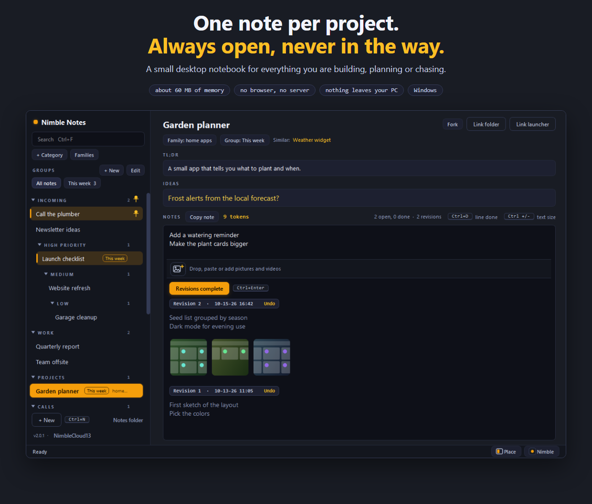
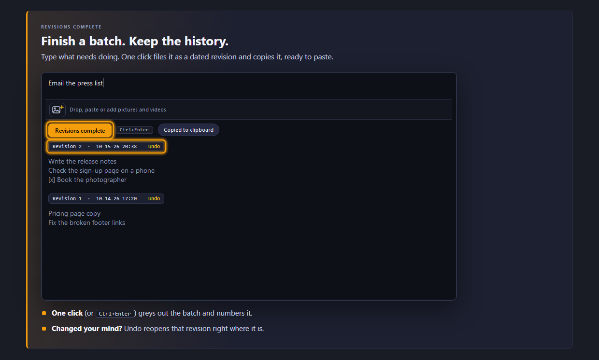
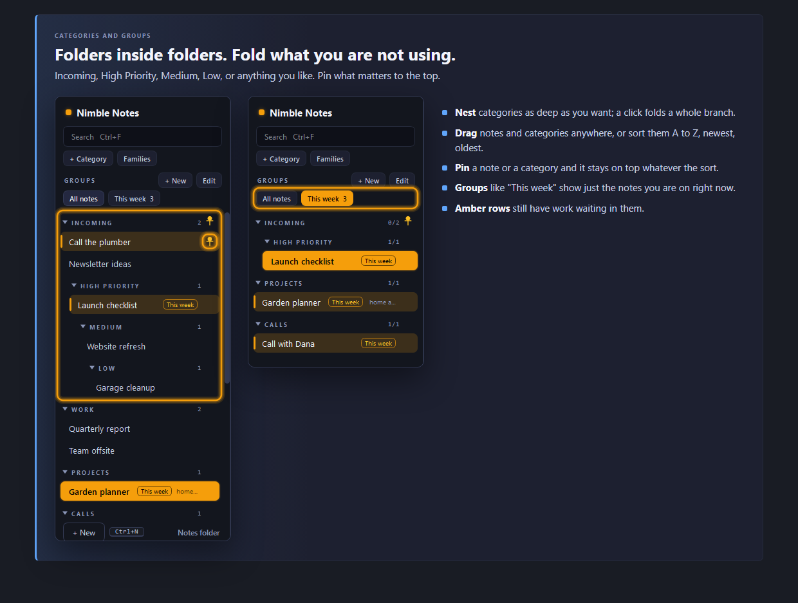
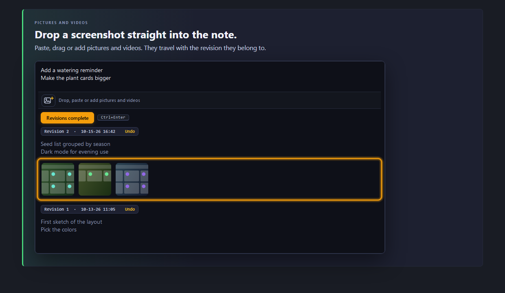
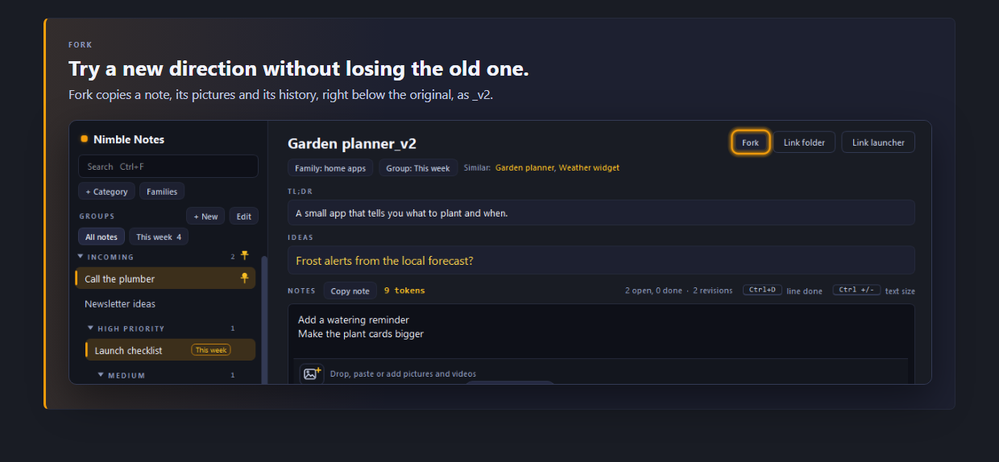
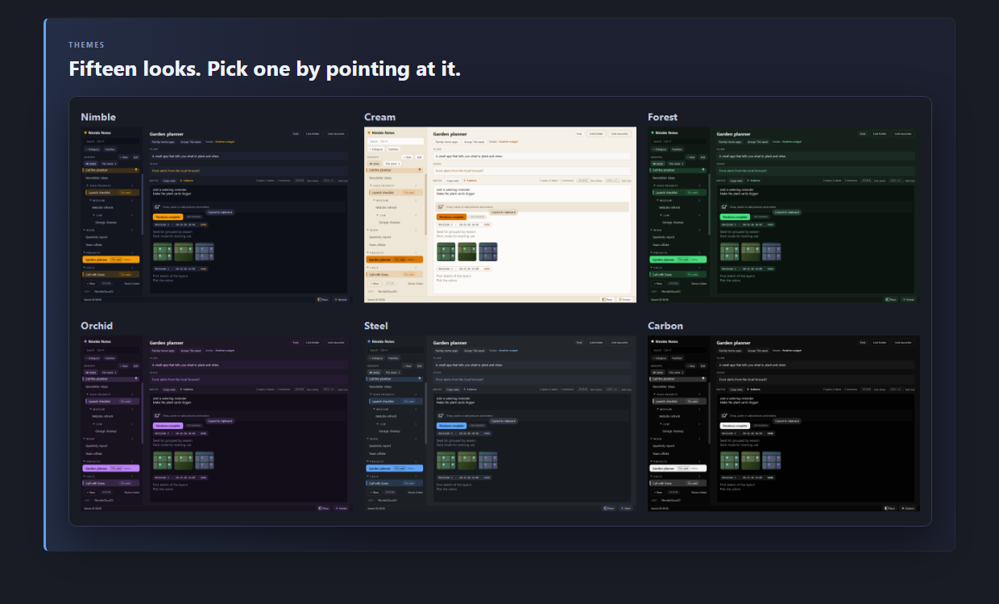
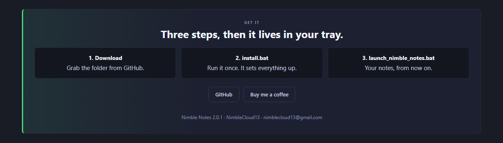

# Nimble Notes

NimbleCloud13 - nimblecloud13@gmail.com - https://github.com/nimblecloud13

One note per app, in a small desktop window you can leave open all day.

It is a native window, not a browser page. There is no server and no port, nothing is downloaded
and nothing leaves this computer. With the window open it holds about 45 MB of memory (the number
Task Manager shows) and uses no CPU while idle. Hidden in the tray it hands most of that back to
Windows.

## A quick look

The same tour as a page: open `Nimble_Notes_Intro.html` in a browser.

## Run it

1. `install.bat` (once). Creates `.venv` and installs the Qt toolkit.
2. `launch_nimble_notes.bat`. The window opens and an amber icon appears in the tray.

Closing the window with the X only hides it. The app keeps running in the tray: click the tray icon
to bring it back, right-click it for **Quit**. Launching it a second time just shows the window that
is already running. From a script, `.venv\Scripts\pythonw.exe app.py --quit` asks the running copy to
save and close.

## The window

- **Left column**: every note, under its category (categories nest; see below). Drag a row to
  reorder it or to move it into another category. Right-click a row for rename, Fork, pin, folder,
  move and remove. Click a category to fold it. Drag the bar between the list and the note to make
  the list narrower or wider. Under the search box: **+ Category** and **Families**, then **Groups**
  with **+ New** and **Edit**, and under that one button per group (see Groups below). The note you
  are on is lit in a lighter, bluer navy; a row with pending revisions has an amber wash and an amber bar, and
  when that note is the one you are on it is lit in the deeper gold instead.
- **TL;DR box** (top right): what the app is for. One line tall while it is empty; it grows to fit
  what is in it.
- **Ideas box** (under it): half-thoughts about the app that are not revision notes yet. Plain
  text, nothing else, in a lighter gold and a little larger than the notes so it stands out. Also one line tall while
  empty, growing with its text. Saved as `ideas.txt` in the entry's folder.

  Both boxes stop growing when the notes would be squeezed (the taller the window, the further
  they go) and scroll from there.
- **Notes pane** (the rest): your notes for that app. It scrolls on its own, as one piece. The gold
  number on its label row is the size, in tokens, of what you are writing.

Everything saves by itself about a second after you stop typing. The status bar shows the time of
the last save.

| Keys | Does |
| --- | --- |
| Ctrl+Enter | Revisions complete: grey out everything typed and file it as the next revision |
| Ctrl+D | Tick off just the current line (or every selected line), or bring it back |
| Ctrl + and Ctrl - | Notes text bigger or smaller. Ctrl+0 puts it back. Ctrl with the mouse wheel works too |
| Ctrl+F | Search names, family, TL;DR, ideas and note text. Esc clears it |
| Ctrl+N | New entry under the current one |
| Ctrl+G | Switch the list between the group shown last and every note |
| F2 | Rename the current entry (or double-click its name) |
| Del | Remove the entry selected in the list (a toast offers Undo) |
| Mouse back / forward | Walk through the entries you visited |

## Revisions complete

The notes pane reads top to bottom like this:

1. The text you are typing.
2. The picture strip: an add-picture button and an 80 px thumbnail of every picture on the notes
   you are typing. It is the border between your text and the button.
3. The **Revisions complete** button. It moves down as you type, like part of the text.
4. Everything you have finished so far, greyed out, newest first, each batch under a tag with its
   revision number, date and time. The newest tag sits right under the button.

Press the button (or Ctrl+Enter) when a batch of notes is done. All of it is greyed out and filed
as the next revision, counting up from 1, and the space above is cleared for new notes. Nothing is
struck through: finished text stays easy to read, just clearly dimmer than live text.
A toast offers Undo.

Revisions complete also copies what was just completed to the clipboard (the entry's name, a blank
line, then the text), and a small "Copied to clipboard" toast pops up beside the button. The same
happens when a reopened revision is completed again.

When the revision has pictures, each picture is copied first, one at a time about half a second
apart, so that Windows clipboard history (Win+V) holds every one of them and you can paste each
where it is needed. The text is copied last, so a plain Ctrl+V pastes the text. The small toast
counts the pictures as they go and says when the text is on the clipboard. Clipboard history has to
be switched on in Windows (Win+V offers to turn it on). A video cannot go in clipboard history; it
is listed by its path in the text.

Each revision's tag ends in **Undo**: click it and that revision becomes editable again right where
it is, in a box of its own, so you can add to it. Nothing else moves: the text you are typing at the top
of the note is not touched. The tag then reads **Revisions complete**; click it when you are done and the
revision is greyed out again under the same number (its date stamp moves to now if you changed it).
Right-click a tag or a revision for the same things, or to delete the revision.

In the list on the left, any entry whose note still has open lines (typed but not yet marked complete,
or sitting in a reopened revision, and not ticked off with Ctrl+D) is highlighted with an amber wash and an amber bar on its left edge.

Ctrl+D is the small version: it greys single lines inside the text you are still working on.

## Categories

A new list starts with these categories. Incoming is at the top and shows how categories nest:
Incoming holds High Priority, which holds Medium, which holds Low.

    Incoming
      High Priority
        Medium
          Low
    Work
    Projects
    Calls
    Team
    Vibe Coded
    Other

- **Fold**: click a category to hide everything inside it, its subcategories too; click again to
  show it. A search looks inside folded categories, and opening a note unfolds what hides it.
- **Move notes**: drag a note into another category, or right-click it and use **Move to**.
- **Move categories**: drag a category heading. Dropped right under another heading it goes inside
  that category; dropped anywhere else it goes after the category above, at the same level.
  Everything inside it moves with it. Right-click, **Move into**, does the same from a menu.
- **Right-click a category** for: Sort the notes in it, Sort the categories beside it, Fold, Pin to
  the top, Rename category, New subcategory, Move into, Move up or down, Remove category.
- **+ Category**, under the search box, adds one at the top level.
- **Remove category**: its notes go to the category above it (or Other), its subcategories move up
  a level, and a toast offers Undo.

### Sorting

| Sort the notes by | Order |
| --- | --- |
| My order | The order you dragged them into |
| A to Z, Z to A | By name |
| Oldest first, Newest first | By when the note was made (notes from before 2.0 use their app folder's date) |
| Recently edited first | By the last time the note changed |
| Family | Members of a family together, notes with no family last |

The categories beside one another sort by A to Z, Z to A, Oldest first or Newest first. Each
category keeps its own choice for its notes, and its heading shows it in small amber text. Dragging
a note inside a sorted category puts that category back to My order.

### Pins

Every row has a small pin at its right end (shown when the mouse is over the row, and always once
it is pinned). A pinned note stays at the top of its category, and a pinned category stays first
among the categories beside it, whatever the sort. Incoming starts pinned. In a narrow list the
tags go first; then the pin steps aside too.

## Fork

**Fork**, beside the note's name (or right-click a row, Fork), makes a copy right below it named
with `_v2`, or the next free number (`Nimble Cut_v2`, `Nimble Cut_v3`). The copy has the notes,
ideas, TL;DR, family, folder, launcher, groups and pictures.

## New note when you come back

When the window comes back after being out of focus for a minute or more (or the app is opened), a
new note starts at the top of Incoming with its name ready to type. Type the name and press Enter:
the cursor goes straight to the notes. If you click another note instead and leave the new one
blank, it goes away by itself.

## Placing the window

**Place**, in the status bar at the bottom, opens a grid of little screens: a row for half, third
and quarter (each against the left, right, top or bottom) and a row for the four corners. Click one
and the window takes that part of the screen it is on, like Windows+arrow keys. It stays there: it
comes back there after a restart and when the screen changes (a new resolution, the taskbar moved),
until you drag the window somewhere else or pick **Let it move freely**. The same menu has **Full
screen** and, with two monitors, **Move to the next screen**.

**Pin**: when the window is docked to a half, a third or a quarter of the screen (against a side, not
a corner), a **Pin** button shows on the header row beside Open folder. Click it and that strip of the
screen is reserved for Nimble Notes the way the taskbar is: other windows keep out of it and maximize
beside it. The button is lit while pinned; click it again to unpin. Dragging the window away, or
putting it in a corner, unpins it too. While the window is hidden in the tray the strip is given back,
and it is pinned again when the window comes back.

The layout tightens itself in a small window so it still works on a quarter of the screen, even
a small screen. A window narrower than about 380 px shows one pane at a time: the note, with a
**List** button that swaps to the list (picking a note swaps back). A narrow
window leaves out the keyboard hints, the line counts and the Change linked folder button (it is
still in the row's right-click menu), and the chips under the title wrap onto a second line. A very
short window leaves out the TL;DR, the chips under the title and the brand row.

## Themes

**Theme**, beside Place, offers the 14 Nimble themes: Nimble (the default), Cream,
Fog, Deep Sea, Furnace, Coal, Forest, Moss, Orchid, Blush, Graphite, Carbon, Steel and Espresso.
Point at a name to see the whole app in it; click to keep it. Closing the menu without a click puts
the old one back. The tray icon's menu has the same list under Theme. Only the colors change; the
choice is saved and comes back after a restart. The app's icon keeps its own colors.

## Groups

A group is a short list of notes to work on together, so the rest of the list is out of the way.
You can have as many groups as you like, and a note can be in several.

**Seeing a group.** Under the **Groups** label, above the list, there is one button per group, with
how many notes it holds, and **All notes**. Click a group and the list shows only its notes (the
button is lit). Click **All notes** to see everything again. Ctrl+G flips between the two.

**Making a group.** Click **+ New** beside the Groups label. A panel opens with the new group's
name ready to type over and every note on screen at once, in columns under its section. Click the
notes that belong in it, then **Done**.

**Changing a group.** Click **Edit** beside the Groups label (or right-click a group's button). In
the panel:

- the buttons along the top are the groups: click the one to work on, or **+ New group**
- **Name** renames it, **Delete group** removes it (the notes are not touched)
- click a note to put it in the group, click it again to take it out
- click a section heading to add or drop its whole section
- an amber number is how many open lines that note still has, and **Add notes with open lines**
  adds every note that still has open work
- **Undo** steps back through everything changed while the panel is open

**Where it shows.** A note that is in a group wears the group's name as a small outlined tag on its
row in the list, and as a **Group:** chip under its title. Click that chip (or right-click the row,
Groups) to tick the note into or out of any group without opening the panel.

Searching always looks through every note, in a group or not, and the note that is open always
keeps its row. Nothing is moved, renamed or removed by any of this; rows cannot be dragged while
the list shows only one group.

## Families

A family is a tag shared by apps that do the same job or are revisions of each other. **Families**,
under the search box, opens the panel that manages them all in one place:

- every family is listed on the left with how many entries it has
- the right side is one list of every entry, ticked when it belongs to the selected family: tick to
  add, untick to remove (an entry is in one family at a time)
- change the name and press Enter to rename a family for every member at once; use another family's
  name to merge the two
- **Delete family** takes every entry out of it and keeps the entries
- type a name in "New family" and press Enter to start one, then tick its members
- **Undo** steps back through the changes made while the panel is open

For a single entry the Family chip beside its name still works: pick a family, type a new one, or
choose Manage families.

## Pictures and videos

A note takes pictures and videos three ways: the add button at the left of the strip, dragging files
onto the text or the strip, and pasting with Ctrl+V (a screenshot, a copied file, or a browser's Copy
Image). Each one is copied into `images/<entry name>/`; the original is never touched. A pasted
picture is saved there as a PNG. A video shows as a tile with a play mark and opens in your video
player when clicked.

They belong to the batch of notes they were added to. Press Revisions complete and they are filed
with that text: the revision shows its own strip under its text.

Click a thumbnail to enlarge it. In the enlarged view the arrows and the arrow keys step through the
pictures, the mouse wheel zooms, dragging moves a zoomed picture, and Esc closes. **Copy image**, at
the bottom, puts the picture on the clipboard; so do Ctrl+C and the right-click menu, both there and
on a thumbnail.

Hover a thumbnail and a small x appears in its corner. It takes the picture off the note, after a
confirmation that shows the full path where the file still lives, with a copy mark at the end of the
path. Nothing is ever deleted from the images folder by the app. Because of that the folder only
grows: a pop-up with an Open images folder button appears each time it passes another 5 GB.

## Token count

The gold number beside Copy note is how big the update you are writing is, in tokens: every word
and every punctuation mark counts as one (the rule from TokenLite). Click into a revision and it
shows that revision's count instead; click back into your notes and it shows theirs again.

## Copy note

**Copy note**, on the Notes row, puts the whole note on the clipboard: the entry's name, the open
text, then every revision under its number and date stamp, with a blank line between each part.
Pictures are listed by their full path under the part they belong to.

## Family

The small tag on the right of a row is its family. Apps that do the same job, or are revisions of
each other, share a family. The header shows the other members as links. Click the family chip to
pick one or type a new one. The Families panel (above) handles whole families.

## Open folder and Launch

Three buttons sit beside the entry's name.

**Open folder** opens the app's folder in Explorer.

**Change linked folder** is always there, for when the wrong folder was linked. It opens a normal
Explorer folder picker, and a toast offers Undo. On an entry with no folder yet it reads
**Link folder**.

**Launch** runs the app's launch file exactly as a double-click would. The file is looked for each
time the entry is shown, in this order, skipping installers, updaters and the like:

1. `launch_<name>.bat`, then `launch.bat`
2. `run.bat` or `run_<name>.bat`, then `start*.bat` (`.cmd` files count too)
3. a `.bat` named after the folder, or the only `.bat` in it
4. an `.exe` named after the folder
5. the same launch, run and start names one folder down, newest version folder first

When nothing is found the button reads **Link launcher**: click it and point it at the .bat, .exe
or other file that launches the app. After that
it launches that file. Right-click **Launch** to link a different file, or to go back to finding it
automatically.

## Where things are saved

Every entry that has anything in it gets a folder of its own in `notes/`, named after the entry,
for its notes and its ideas (`notes/Nimble Cut/Nimble Cut.txt`, `notes/Nimble Cut/ideas.txt`). Its
pictures and videos go in `images/`, in a subfolder with the same name
(`images/Nimble Cut/screenshot.png`). Renaming an entry renames both folders and the notes file.
The **Notes folder** button at the bottom left opens `notes/`. Everything else is in `data/`:

| File | Holds |
| --- | --- |
| `data/apps.json` | The list in order: name, section, family, folder, launch file, TL;DR (an old development-status value is still stored per entry, unused) |
| `notes/<Name>/<Name>.txt` | The notes for one entry, as plain text |
| `notes/<Name>/ideas.txt` | That entry's Ideas pane |
| `images/<Name>/` | A copy of every picture and video added to that entry's notes. Never deleted by the app |
| `data/removed/` | Removed entries (their notes folder). Right-click the list for Restore removed |
| `data/state.json` | Window size and place, pin, last entry, cursor places, sort choices, notes text size, theme, groups |

A notes file is the open text first, then each revision under a line of its own, newest first:

    still to do
    - [x] a single line ticked off with Ctrl+D
    --- Revision 2 | 10-10-26 20:31 ---
    everything that was finished in the second batch

    --- Revision 1 | 10-10-26 18:02 ---
    the first batch

A revision that was reopened with Undo and is not complete again yet has `| open` in its line:
`--- Revision 2 | 10-10-26 20:31 | open ---`.

Pictures and videos are listed at the end of the part they belong to, one line each:
`[image] screenshot.png` or `[video] clip.mp4`. The file itself is in `images/<Name>/`.

The files can be edited while the app is open. It picks the change up the next time its window is
clicked, and it never overwrites typing that has not been saved yet.

Folders under your home directory are stored as `~/...`, so no user name is written to disk.

## Start with Windows

On by default: the first launch adds a startup entry so Nimble Notes starts hidden in the tray when
you sign in. Turn it off or on from the tray menu. The entry is a value named `NimbleNotes` under
`HKCU\Software\Microsoft\Windows\CurrentVersion\Run`.

## Files

- `app.py` - the window, tray icon and startup
- `store.py` - reading and writing the files in `data/`
- `media.py` - the picture strip, the enlarged picture view, the small pop-up, the resize grip
- `theme.py` - the stylesheet, built from the theme picked
- `nimble_themes.py` - the 14 Nimble themes (a copy from the nimble-themes skill)
- `notes/` - your notes: one folder per entry, holding its notes and ideas
- `images/` - your pictures and videos: one folder per entry
- `backups/` - copies of `data/` taken before an upgrade
- `logs/` - `nimble_notes.log` is written only if something goes wrong

## Links

**NimbleCloud13**, beside the version number at the bottom left, opens a small card with links to
GitHub (github.com/nimblecloud13) and Buy me a coffee (buymeacoffee.com/nimblecloud13). Nothing is
opened until you click one.

## Resizing

The whole bottom right corner resizes the window: everything between the corner of the notes box and
the corner of the window is a grab area, though nothing is drawn there.
